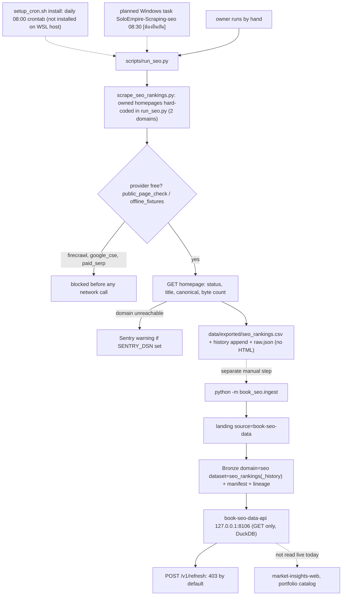
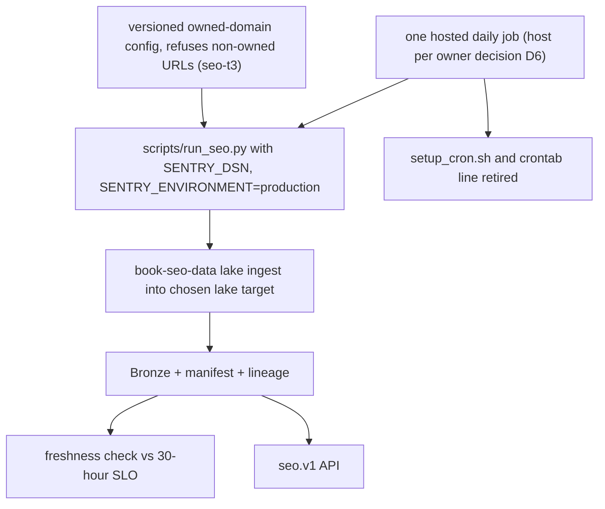

# 01 — Business process (As-Is / To-Be)

marketing-seo-ranking-data (`book-seo-data`) ตรวจว่า homepage ของโดเมนที่ owner เป็นเจ้าของตอบได้หรือไม่ พร้อมบันทึก HTTP status, title และ canonical แบบ lake-first แล้วให้อ่านเป็น `seo.v1` บน `127.0.0.1:8106` แม้ชื่อ dataset จะเป็น `seo_rankings` แต่ไม่ได้เก็บอันดับ search engine

Last reviewed: 2026-11-28 · commit `d2b2153`

## As-Is (จากโค้ดวันนี้)

Sources: `scripts/run_seo.py`, `scripts/scrape_seo_rankings.py`, `setup_cron.sh`, `src/book_seo/ingest.py`, `src/book_seo/api.py`, `src/book_seo/policy.py`, `src/book_seo/lake.py`, `PRODUCT.md`, `DATA-CONTRACT.md`

ข้อเท็จจริงจากโค้ดและเอกสาร:

- capture (CSV) กับ lake ingest เป็นสองคำสั่งแยกกัน และ ingest ไม่ได้ตั้งเวลา (`PRODUCT.md` §Runtime status)
- ไม่มี hosted deployment และยังไม่มี `SENTRY_DSN` ตั้งไว้ที่ใด [ต้องยืนยัน]
- `load_previous_rankings` ใช้ keyword อย่างเดียวเป็น key (`src/book_seo/ingest.py`)

## To-Be (`specs/001-l2-baseline/spec.md` §Schedule, `PRODUCT.md` §Known gaps, `docs/UPGRADE-PLAN.md`)

Sources: `specs/001-l2-baseline/spec.md`, `PRODUCT.md`, `docs/UPGRADE-PLAN.md`

## Gap

| ID | As-Is → To-Be | Status | Owner | Evidence |
|---|---|---|---|---|
| G1 | ไม่มี host สำหรับตารางเวลา (crontab ไม่ได้ติดตั้ง, Windows task ไม่ยืนยัน) → hosted daily job เดียว | decide | owner | `specs/001-l2-baseline/spec.md` §Schedule (D6 open) |
| G2 | capture กับ lake ingest แยกกันและ ingest ไม่ตั้งเวลา → job เดียวรัน capture แล้ว ingest | blocked | claude | `specs/001-l2-baseline/spec.md` §Schedule (รอ G1) |
| G3 | ไม่มีการตรวจความสด → freshness check เทียบ SLO 30 ชั่วโมง | blocked | claude | `specs/001-l2-baseline/spec.md` §Schedule (รอ G1) |
| G4 | รายชื่อโดเมน hard-code ใน `scripts/run_seo.py` → config แบบมี version ที่ปฏิเสธ URL ที่ไม่ใช่ของ owner | todo | claude | `PRODUCT.md` §Known gaps (roadmap seo-t3) |
| G5 | ชื่อ dataset `seo_rankings` ชวนเข้าใจว่าเป็นอันดับ → เปลี่ยนชื่อด้วย schema ใหม่ `seo.v2` | todo | claude | `PRODUCT.md` §Known gaps (roadmap seo-t1) |
| G6 | Bronze → API ตรง ไม่มี Silver quality gate → มี Silver gate ใน lineage | todo | claude | `PRODUCT.md` §Known gaps |
| G7 | coverage gate 68% → พื้น 80% (เพิ่มเทสต์ `ingest.py`, `api.py`, `http_client.py`) | todo | claude | `PRODUCT.md` §Known gaps; `.github/workflows/ci.yml` `coverage-threshold: "68"` |
| G8 | `load_previous_rankings` key ด้วย keyword → key ด้วย keyword + target domain | todo | claude | `docs/UPGRADE-PLAN.md` P2; `src/book_seo/ingest.py` |
| G9 | ไม่มี extra `dev` และ `[build-system]` → มีครบ | done | claude | `docs/UPGRADE-PLAN.md` (SPEC-001, 2026-10-22); `pyproject.toml` |

## Open questions

- การนำเข้าอันดับจริง (Search Console) อยู่นอก scope ทั้งใน `PRODUCT.md` และ SPEC-001; ต้องการหรือไม่
